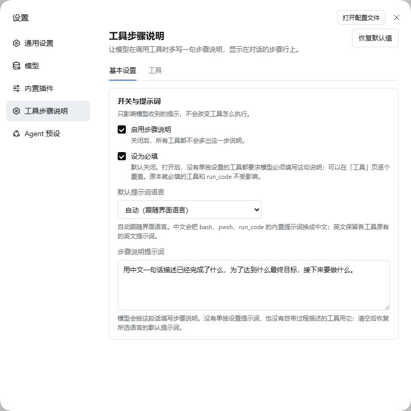

<div align="center">

# Step Note

A one-line, model-written step note for every DeepSeek Harness tool call, so you can see what the model is doing right now.

[简体中文](./README.md) | English

[](https://www.npmjs.com/package/@xiaoso/dsh-tool-step-note)
[](LICENSE)
[](https://nodejs.org)
[](https://github.com/deepseek-ai/deepseek-harness)

</div>

## Features

- **A description field for tool calls**: enabled tools get a model-written `description`, shown on the chat step row and the tool card.
- **Per-tool prompt customization**: override the prompt for that description by language and by tool.

## Installation

### From npm

Requires Node.js ≥ 22.19 (or ≥ 24) and DeepSeek Harness 0.2.1+.

**Web**

```bash
dsh plugin --profile web add @xiaoso/dsh-tool-step-note
dsh web
```

**Desktop**

1. Open **Plugins** in the sidebar, then **Add plugin** → **Install third-party plugin**.
2. Enter `@xiaoso/dsh-tool-step-note` and click **Install**.
3. Restart DeepSeek Harness.

After installation, **Tool Step Notes** appears in Settings.

## Usage

### Basics

- **Enable step notes**: master switch.
- **Require the note**: off by default. When on, tools without their own setting must include the note; each tool can override it on the Tools tab.
- **Default prompt language**: follow the interface language automatically, or pin Chinese/English. Blank prompts follow the selected language.
- **Step note prompt**: used by tools that have no separate prompt and no description of their own.



### Tools

Enabled by default: edit, read, write, bash, pwsh, grep, glob, job_list, job_output, job_kill.

Each checked tool has three settings:

| Setting | What it does | Default |
| --- | --- | --- |
| **Use a separate prompt** | Replaces the tool's prompt as a whole; leave it unchanged to follow the selected language | Unchecked |
| **Required** | The model must include the note | Follows the switch in Basics; override per tool |
| **Replace the tool card** | Draws the note as a compact card instead of the native one; priority must be below 0 (default -1000) | On for read, write and edit |

**read, write and edit are replaced by default**: their native cards show a path, not the note, so without replacement the note only flashes while the tool runs. bash, pwsh, grep and glob already show it; task, goal and plan tools are result cards; ask_user_question, skill and present are interactive UIs, so their native cards stay. The trade-off: native details are not reproduced, but file paths and diffs remain.

### run_code

run_code belongs to PTC mode. It already has a step note and is always required, so the plugin does not add a second field. Its separate prompt is unchecked by default and uses the built-in prompt; editing it pins your text.

### Try it

In standard mode, send this to trigger several tools at once:

```text
Give this project a quick health check: read package.json, tsconfig and tsdown.config.ts, search for leftover TODO comments, then run pnpm build. Check only — do not change files — and report the result.
```

To see the run_code card, switch to PTC mode and ask it to print 1+1.

## Notes

- The plugin only changes the model-visible schema; it does not change a tool’s registered validation.
- The note on the step row is visible only while the tool runs. Fast tools such as read and write keep it by replacing their card.
- Tools whose parameter root declares `additionalProperties: false` are skipped; tools with a fixed description (enum/const) cannot be changed; MCP tools may reject the extra argument, so confirm the server accepts it first.
- The prompt language is resolved on every request; card replacement is re-registered immediately after saving.

## License

[MIT](LICENSE)
