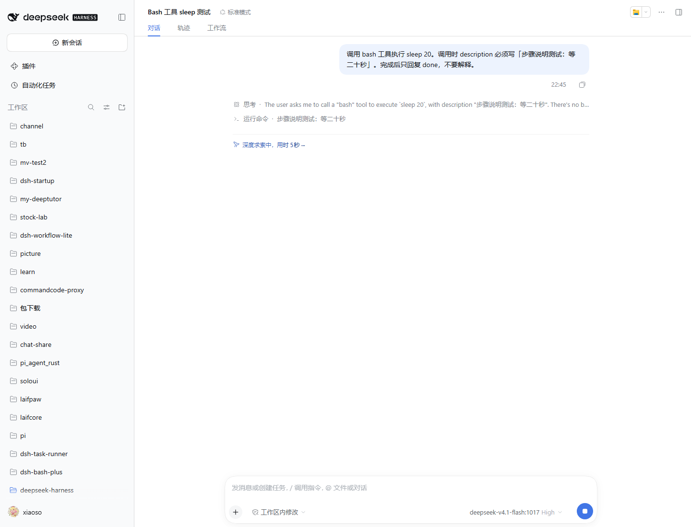
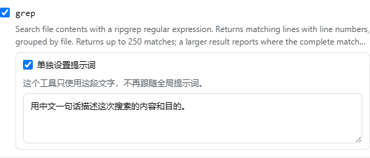

# @xiaoso/dsh-tool-step-note

DeepSeek Harness 插件：给启用的工具加一个由模型填写的 `description` 参数，并把这句话显示在对话的步骤行上。标准模式和 PTC 模式都适用。



## 安装

适配 DeepSeek Harness 0.2.x（0.2.1 起，含预览版），需要 Node.js 22+。当前从本地目录安装：

```bash
dsh plugin --profile web add "D:\code\pi-gateway-project\dsh-tool-step-note"
dsh web
```

安装后，设置里会出现「**步骤说明**」。卸载：

```bash
dsh plugin --profile web remove @xiaoso/dsh-tool-step-note
```

## 使用

设置 → **步骤说明**，页面分「基本设置」和「工具」两个标签。

- **基本设置**：总开关、设为必填、替换工具展示卡片、全局提示词。
- **工具**：选择哪些工具需要步骤说明。默认开启 edit、read、write、bash、pwsh、grep、glob、job_list、job_output、job_kill。


工具默认保留自带的步骤描述；没有自带描述的，使用「基本设置」里的全局提示词。勾选「单独设置提示词」后，这个工具整段改用你写的文字；默认 bash、pwsh、run_code 勾选，内容是插件内置的中文提示词（要求主动语态、5 到 15 个词，并带示例）。



修改后点保存，下一次模型请求立即生效，无需重启。**恢复默认值**只填入草稿，保存后才写入。

「**替换工具展示卡片**」默认关闭。这些工具的原生卡片不渲染模型写的说明，所以不替换的话，说明只在运行中的步骤行闪一下、结束后就看不到。开启后，read、write、edit 和 job_list / job_output / job_kill 的卡片换成本插件绘制的一行，说明会一直留在卡片上；关闭后立即恢复 DSH 原生卡片。代价是原生卡片里的行号视图、结构化任务回执不会复现；文件路径仍可点开，edit / write 仍会显示 diff。

### run_code

run_code 单独一张卡片。它本来就有步骤说明，且始终必填，插件不会再加第二个字段；单独设置提示词只在 PTC 模式生效。

## 说明

- 插件只改「模型看到的 schema」，不改工具注册时的参数校验。
- 步骤行里的这句话只在工具「运行中」显示。read、write 这类瞬间结束的工具默认结束后就看不到了；打开「替换工具展示卡片」可以让它留在卡片上。
- 参数根声明 `additionalProperties: false` 的工具会跳过；固定过程描述（enum、const）的工具不能修改；MCP 工具可能不接受额外参数，启用前请确认对应服务允许额外字段。

## 开发

```bash
pnpm install
pnpm build
node --experimental-strip-types --no-warnings test/inject-check.mjs
```

## License

MIT
