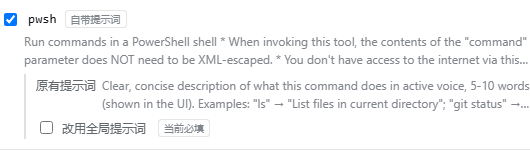

# @xiaoso/dsh-tool-step-note

给启用的工具 schema 增加一个由模型填写的 `description` 参数，并显示在对话的步骤行上。已有 `description` 的工具默认保留自己的提示词，可按工具选择是否覆盖。


## 效果

- 模型调用工具时多填一个 `description`：一句话说明这一步做什么。
- 步骤行显示成 `准备读取文件 · Read the first line of README.md`。
- 标准模式和 PTC 模式都适用；PTC 下 `run_code` 本来就有 `description`，默认只保留它自己的提示词，不新增第二个字段。
- 工具本来就有顶层 `description` 时（例如 `pwsh`、`subagent`、`workflow_lite`），默认不改它的提示词；在设置页勾选「改用全局提示词」才替换。
- 插件只改「模型看到的 schema」，不改工具注册时的参数校验。因此工具的参数根必须允许额外字段；声明 `additionalProperties: false` 的工具会被跳过。

## 安装

本机全局 `dsh`（0.2.1-rc.2）：

```sh
dsh plugin --profile web add D:\code\pi-gateway-project\dsh-tool-step-note
```

`dsh plugin add` 会把包装进 profile 依赖和 `dsh.profile.bundles`；本包的 `cordis.patch.yml` 随即作为一个 bundle 层插入 `step-note` 行。重启 `dsh --profile web` 生效。

卸载：

```sh
dsh plugin --profile web remove @xiaoso/dsh-tool-step-note
```

## 设置

设置 → **步骤说明**。整个设置页只有一个滚动区域；有改动时，保存条出现在底部。

### 行为

- **启用步骤说明**：总开关。关闭后不改写任何工具的参数。
- **设为必填**：默认关闭。打开后本插件管理的 `description` 都会进入 `required`；关闭时不新增必填。原本就必填的工具（如 `pwsh`、`subagent`）和 `run_code` 保持必填。
- **参数字段说明**：新增字段、或选择覆盖时使用的提示词。默认：
  `One short sentence describing what this step does or is about to do, in the user's language. Shown next to the step in the UI.`

### 工具



- 工具按「已开启的工具 / 未开启的工具」分组，提供搜索框和三个筛选：全部、已开启、有原提示词。
- 每个工具显示名称、工具说明，以及 `MCP` / `严格参数` / `自带提示词` / `固定提示词` 标记。
- 本来就有 `description` 的工具会展开：显示**原有提示词**；开启后可勾选「改用全局提示词」，默认不勾选，保留原提示词。
- 严格参数工具、固定提示词（`enum` / `const`）工具不能勾选，页面上会标明原因。
- `run_code` 是 PTC 保留工具，不在列表里，单独一张卡片：始终必填，内置提示词可展开查看，改用全局提示词的开关默认关闭。当前部署未启用 PTC 时显示内置默认提示词和说明。

### 保存与恢复

- 有改动时保存条出现在底部，显示未保存 / 已保存 / 保存失败状态。
- **恢复默认值**在页面右上角，只把默认值填进草稿，点**保存**才写入；不会立即改配置。
- 与当前有效值相同的字段不写；恢复默认且该字段确实有用户覆盖时，保存会用 `unset` 清掉用户层，回到 schema 默认值。
- 保存后下一次模型请求立即使用新配置，无需重启。

## 限制

- 步骤行详情只在步骤「运行中」显示：工具结束后标题回到「已读取文件」这类完成态。这是客户端现有行为（`LIVE_TOOL_DETAIL_KEYS` + 仅 `closed === false` 时显示），本插件不改 DSH 源码。
- 参数根声明 `additionalProperties: false` 的工具在页面上标记为「严格参数」并跳过；顶层已有 `description` 且类型不是字符串（`enum` / `const`）的工具也跳过。
- MCP 工具可能拒绝未声明的参数，页面会标 `MCP`；启用前请确认对应服务器允许额外字段。
- 工具名册读取注册表的 layer map：`ToolRuntime.schemas()` 只投影单个 scope，公开 API 没有「所有 scope」枚举。读取带防御性回退，DSH 私有字段若改名，页面退化为全局视图 + 已见过的工具，不会崩。

## 开发

```sh
pnpm install
pnpm build
node --experimental-strip-types test/inject-check.mjs
```

- 宿主：`src/config.ts`（设置 schema 与热更新解包）、`src/inject.ts`（纯函数改写）、`src/index.ts`（`system-prompt/assemble` 监听、工具名册）、`src/rpc.ts`（`/step-note/tools` 路由）。
- 客户端：`src/client/*`（设置页、字典、表单值）。
- 构建产物：`lib/index.mjs`（宿主，ESM）、`lib/client.js`（浏览器闭包工厂）、`lib/types`（声明）。

## 已验证

- 设置页列出 35 个工具；其中 4 个已有顶层 `description`：`pwsh`、`subagent`、`subagent_fork`、`workflow_lite`。
- 默认 `required` 关闭：请求头里 `read` 的 `required` 只有 `file_path`，但 `description` 使用全局提示词。
- 默认不覆盖：请求头里 `pwsh` / `subagent` / `workflow_lite` 保持各自原有提示词。
- 只对 `pwsh` 和 `subagent` 改用全局提示词后，下一次请求头中这两个工具的 `description` 提示词变成全局提示词，`workflow_lite` 仍保留原文。
- 恢复默认值并保存后，下一次请求头恢复为：`read` 可选 + 全局提示词，`pwsh` / `subagent` / `workflow_lite` 原提示词。
- 模型实际调用时填入，例如 `"description": "Read the first line of README.md"`；步骤行显示 `准备读取文件 · Read the first line of README.md`，`web_search` 显示 `正在搜索网页 · 搜索 deepseek harness 最新消息`。
